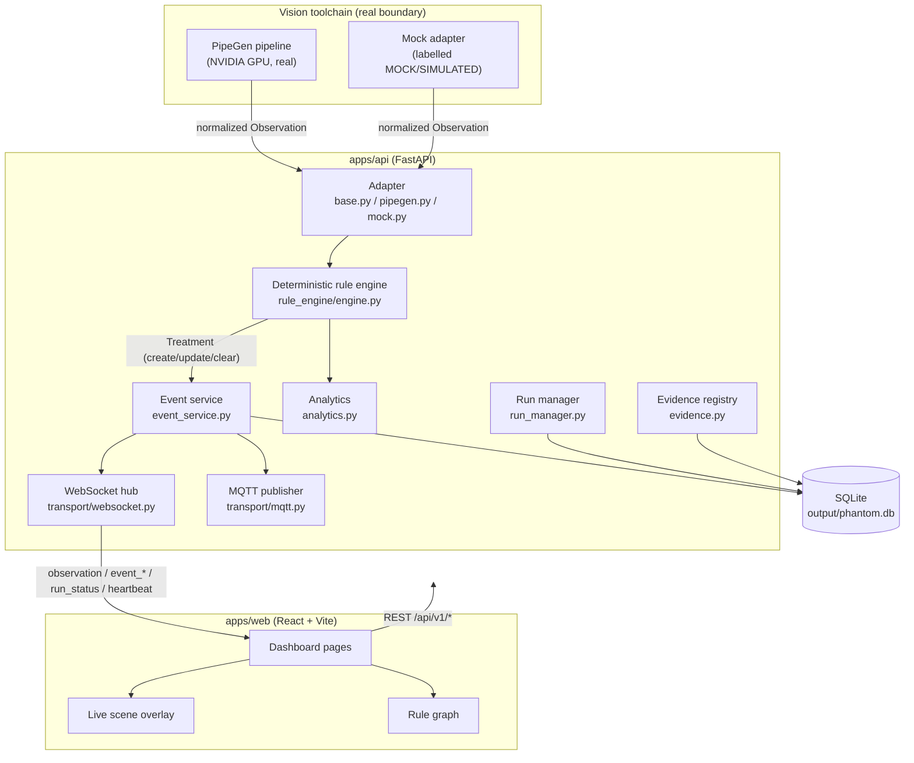

# Architecture

PHANTOM is a layered system with a hard boundary between the vision toolchain
(PipeGen) and everything else. The rule engine, event store, transport and UI
have no knowledge of how frames are produced.

## Data flow



## Boundary definition

The adapter boundary is the single integration point:

- **Inputs to the boundary:** nothing above it may assume how frames are made.
- **Output of the boundary:** a normalized `Observation` (see
  `docs/EVENT_SCHEMA.md` and `packages/contracts/schema/observation.schema.json`).
- **Implementations:**
  - `adapters/mock.py` — deterministic, `is_simulated = true`, `adapter_kind = "mock"`.
  - `adapters/pipegen.py` — real path; preflight reports local configuration
    readiness only and never fabricates metrics.

The rule engine, event service, transport and UI consume `Observation` objects
and never import adapter internals.

## Determinism

Given identical ordered observations and the same rule/region definitions, the
engine produces identical events. Track history is bounded (`HISTORY_LENGTH`),
stale tracks expire after `stale_track_seconds`, and dedup/cooldown state is
explicit (see `docs/RULES.md`).

## Boundary diagram (textual)

```
+----------------------+     Observation      +-----------------------------+
|  PipeGen  (real)     | -------------------> |                             |
|  Mock  (labelled)    |                      |  Rule Engine -> Event Store |
+----------------------+                      |        -> WebSocket/MQTT    |
        ADAPTER BOUNDARY                       +-----------------------------+
                                                 Transport -> React UI
```

Everything to the left of the boundary may be replaced without changing
anything to the right.
